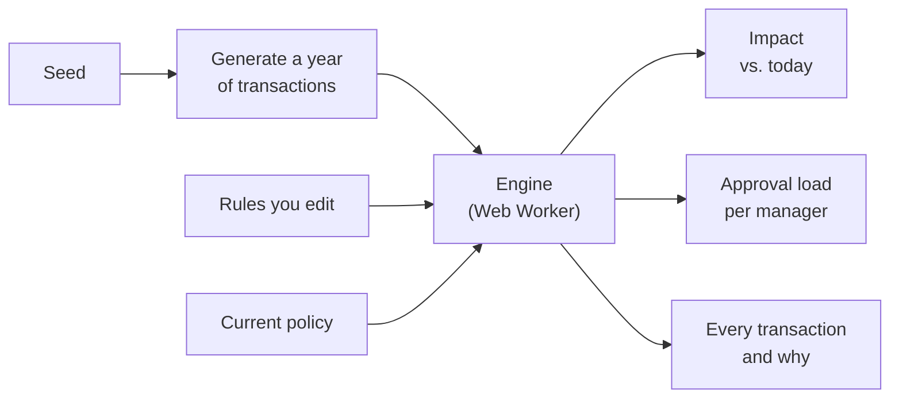
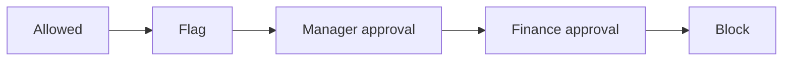

<div align="center">

# Dry Run

**Test a card policy on a year of spend before you roll it out.**

Change a rule and instantly see what it would have flagged, how much spend it catches,<br>
and how many approvals it puts on each manager's desk.


</div>

---

## The problem

Every policy change trades **control** for **friction**.

Lower the meal limit and you review more spend, but managers approve more expenses every week. Most finance teams make that call on gut feel, because the alternative is to roll the rule out and wait.

Dry Run replays a year of transactions against your new rules, so you see the trade-off first.

```text
  Lower "Big meals" from $100 to $50

  Spend under review    + $X         ▲ control
  Approvals per week    + Y          ▲ friction
  Busiest manager       5 → 20 a week
  Employees affected    N
                                     evaluated 200,000 transactions in ~8 ms
```

<sub>A sketch of the impact readout. Real numbers will come from the engine once it's built.</sub>

---

## How it works



1. **Generate.** A seed produces a realistic year of card spend: 200,000 transactions across 400 employees, 6 departments and 3 currencies. The same seed always gives the same data, so a shared link always shows the same numbers.
2. **Evaluate.** Every transaction is checked against every rule in one pass. The strictest matching action wins.
3. **Compare.** The results are compared with the current policy: what's newly flagged, what's no longer flagged, and who has to approve it.

### Rules

A rule is a list of conditions that must **all** match, plus one action. To express OR, you add a second rule.

| Rule | When | Then |
| --- | --- | --- |
| Big meals | Meals · over $100 | Manager approval |
| Missing receipt | Over $75 · no receipt | Flag |
| Expensive travel | Travel or Lodging · over $1,500 | Finance approval |
| Large software buys | Software · over $1,000 | Block |

When several rules match, the transaction gets the strictest action:



Rule order never changes an outcome, and adding a rule can never make anything less strict.

---

## Design choices

| Choice | Why |
| --- | --- |
| **Typed arrays, one per field** | 18 bytes per transaction. The hot loop reads plain numbers, and the dataset copies to a worker in one step. |
| **Money in integer cents** | Floating-point totals drift. Currency is converted once and rounded once, and only display code divides by 100. |
| **Flat rules** | The builder is a list and the engine is a loop. Nesting would make both much harder to explain. |
| **Strictest action wins** | Outcomes don't depend on rule order, so they're easy to predict and easy to test. |
| **Plain TypeScript engine** | No React and no DOM, so it moves into a Web Worker unchanged and is simple to test. |
| **No backend** | Nothing to host, secure or log into. Open the link and use it. |

---

## Roadmap

- [ ] **Scaffolding.** Vite, React, strict TypeScript, Vitest, CI and a live deploy
- [ ] **Engine.** Seeded data generator, rule compiler, one-pass evaluator and property tests
- [ ] **Rule builder and impact panel.** Edit rules and see the change from today's policy
- [ ] **Transactions table and approval-load chart.** A virtualized table showing why each transaction got its outcome
- [ ] **Polish.** Web Worker, shareable links, undo and redo, mobile layout
- [ ] **"Where should the limit be?"** Spend caught vs. approvals for every possible limit

---

## Tech

**React** · **TypeScript** · **Vite** · **Web Workers** · **Vitest** · **fast-check**

<sub>All data is synthetic. No real people, companies or transactions.</sub>
