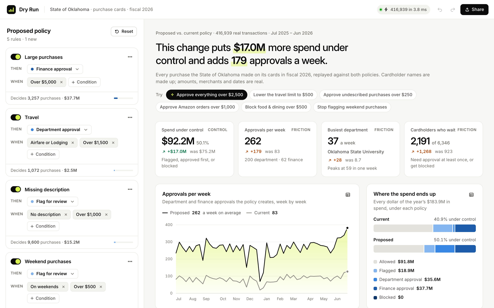
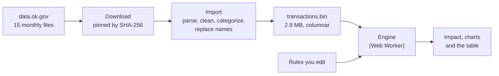
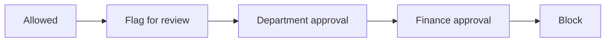

<div align="center">

# Dry Run

**Test a card policy on a year of real spend before you roll it out.**

Change a rule and instantly see what it would have done to 416,939 real purchases:<br>
how much more spend it puts under control, and how many approvals it puts on each department's desk.

[](https://github.com/pranavb1924/Dry-Run/actions/workflows/ci.yml)




</div>

---

## The problem

Every card policy trades **control** for **friction**.

Lower an approval threshold and more spend gets reviewed, but approvers get more requests every week and more cardholders wait. Most finance teams make that call on instinct, because the alternative is to roll the rule out and see what happens.

Dry Run replays a year of real transactions against the proposed rules, so you see the trade-off first. On the State of Oklahoma's purchase cards, for example:

> Requiring department approval for every purchase over $2,500 puts **$17.0M** more spend under control, but takes approvals from **83 to 262 a week**. Oklahoma State University's approvers go from 9 a week to 37, and 59 in their busiest week.

Every one of those numbers comes from the state's published transactions. Nothing is simulated.

---

## What you can do

- **Edit the proposed policy** in place: turn rules on and off, change what they do, and add conditions on amount, category, merchant, department, weekends, or missing descriptions.
- **See the impact as you type:** spend under control, approvals per week, the busiest department, and the cardholders who'd have to wait, each compared with the current policy.
- **Try scenarios** like "Approve Amazon orders over $1,000" or "Block food & dining over $500".
- **Search all 416,939 transactions,** filter to what changed, and open any one to see, rule by rule and condition by condition, why it got its outcome.
- **Undo, redo, and share:** the address bar always holds both policies, so a link opens the exact comparison.

---

## The data

Every purchase the State of Oklahoma made on its purchase cards in fiscal 2026 (July 1, 2025 to June 30, 2026), as published on [data.ok.gov](https://data.ok.gov).

| | |
| --- | --- |
| Transactions | 416,939 ($183.9M spent, $3.2M refunded) |
| Agencies | 118 |
| Cardholders | 6,346 |
| Merchants | 29,615, cleaned from 147,092 raw names |
| Spend categories | 15, grouped from 426 merchant category codes |

**How it's prepared.** The importer handles every format difference between the monthly files (an extra column, a padded header, two kinds of line ending, an invisible byte order mark, refunds written as `$(1,234.56)`), merges merchant spellings (Amazon alone appears under dozens of order codes), and writes out abbreviated agency names.

**Privacy.** The state publishes cardholder names. The importer replaces each one with a made-up name, so real names never reach the app or this repo.

**The current policy is an example,** typical of a public-sector card program. The state doesn't publish its rules in a form that can be replayed.

---

## How it works



1. **Import, once.** `npm run data:download` fetches the 15 source files and checks each against a pinned checksum, so the data can't change without notice. `npm run data:import` turns them into one compact file, which is committed.
2. **Load.** The browser downloads the 2.9 MB file and decompresses it. The columns are used as typed arrays directly, with no parsing step.
3. **Evaluate.** A Web Worker replays both policies over every transaction on each edit, in about 5 ms, and sends back the results as transferred typed arrays.
4. **Compare.** The page shows what changed: control gained, friction added, and which transactions moved.

### Rules

A rule is a list of conditions that must **all** match, plus one action. To express OR, you add a second rule. The example current policy:

| Rule | When | Then |
| --- | --- | --- |
| Large purchases | Over $5,000 | Finance approval |
| Travel | Airfare or Lodging, over $1,500 | Department approval |
| Missing description | No item description, over $1,000 | Flag for review |
| Weekend purchases | On a weekend, over $500 | Flag for review |

When several rules match, the transaction gets the strictest action:



So rule order never changes an outcome, adding a rule can never make anything less strict, and refunds never match a rule.

---

## Design choices

| Choice | Why |
| --- | --- |
| **Real, pinned public data** | A reviewer can trust numbers they can rebuild. The download script checks every file against a checksum, and `npm run data:import` reproduces the committed data file. |
| **One typed array per field** | 15 bytes per transaction. The hot loop reads plain numbers, and the whole year moves to the worker in one transfer. |
| **Money in integer cents, parsed as text** | Amounts never pass through floating point (`4.35 * 100` is `434.99999999999994` in JavaScript). A shape the parser doesn't recognize stops the import instead of being guessed at. |
| **Rules compiled to ranges and lookup tables** | Checking a condition is an array read, never a string comparison. Rules run strictest first, each over only the purchases no stricter rule has claimed, so the work shrinks as it goes. |
| **Engine in a Web Worker** | The page stays responsive while typing. While the worker is busy, only the latest edit waits, so fast typing never builds a backlog. |
| **A table that scrolls 416,939 rows** | Only the rows on screen are drawn, and past the height browsers allow, the scrollbar is scaled. |
| **No backend** | The data is fixed, public and small, so the "backend" work (cleaning 522,596 messy rows) runs once ahead of time. There's nothing to host, secure or log into. |
| **No chart library** | Four hand-drawn SVG and CSS charts, each with keyboard tooltips and a table view, so no value depends on hovering or telling colors apart. |

---

## Tests

82 tests, run by CI on every pull request along with type-checking and a production build.

- **Parsing:** every format difference found in the real files, and errors that name the line they happened on.
- **Cleaning:** category rules, merchant names, agency names, made-up names that never match the real person.
- **Engine:** each condition and action, plus property tests with [fast-check](https://fast-check.dev) on thousands of random datasets and policies. These check the optimized evaluator against a deliberately simple reference version, and check that rule order never changes an outcome, adding a rule never makes anything less strict, and the "why" panel always agrees with the engine.
- **App state:** share links round-trip and reject tampering, and undo groups quick edits.

---

## Run it locally

Requires Node 22.12 or newer.

```bash
npm install
npm run dev         # start the app at http://localhost:5173
npm test            # run the tests and re-run them on every change
npm run typecheck   # check the app and the scripts with strict TypeScript
npm run build       # type-check, then build the site into dist/
```

The data file is already in the repo. To rebuild it from the source:

```bash
npm run data:download   # fetch the 15 files into data/raw/ (98 MB, git-ignored)
npm run data:import     # rebuild public/data/transactions.bin
```

### Project layout

```text
scripts/       the data pipeline, run in Node: download, parse, clean, import
src/engine/    the policy engine: rules, evaluation, statistics, queries, worker
src/data/      the data file format and the browser loader
src/app/       page state: default policies, formatting, share links, undo
src/ui/        React components: policy editor, impact, charts, table, drawer
```

---

## Deploy

The site is static. [`netlify.toml`](netlify.toml) builds it with `npm run build` and publishes `dist/`. Connect the repo in Netlify and every push to `main` deploys.

---

## Roadmap

- [x] **Scaffolding.** Vite, React, strict TypeScript, Vitest, CI
- [x] **Data.** Real Oklahoma card data: pinned download, importer, cleaning, made-up names
- [x] **Engine.** Compiled rules, one pass per rule, statistics, property tests
- [x] **Rule editor and impact panel.** Edit rules and see the change from today's policy
- [x] **Transactions table and charts.** Every transaction, and why it got its outcome
- [x] **Polish.** Web Worker, shareable links, undo and redo, mobile layout
- [ ] **Live deploy** on Netlify
- [ ] **"Where should the limit be?"** Spend caught vs. approvals for every possible threshold
- [ ] **Dark mode**

---

## Tech

**React** · **TypeScript** · **Vite** · **Web Workers** · **Vitest** · **fast-check**

<sub>Data: State of Oklahoma purchase card transactions, published on data.ok.gov. Cardholder names are made up.</sub>
